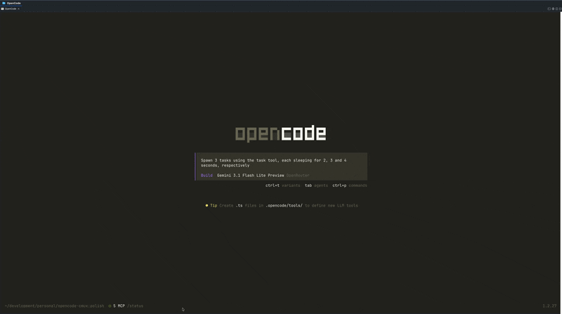

# opencode-cmux



An [OpenCode](https://opencode.ai) plugin that integrates with [cmux](https://github.com/nicholasgasior/cmux) to give you visibility into subagent sessions running in your terminal.

When OpenCode runs inside cmux, subagent sessions automatically get their own TUI pane so you can see what agents are doing without any manual setup.

> **macOS only** — cmux is a macOS terminal multiplexer.

---

## Why sidebar notifications matter

AI agents run for minutes at a time. You switch to a browser tab, write a Slack message, or review a different file — and lose track of where the agent is.

Sidebar notifications close that gap. The cmux status bar shows the agent's current state at a glance:

| Status | Meaning |
|---|---|
| **Working** | Agent is actively processing |
| **Needs Permission** | Blocked until you approve a tool call |
| **Has a Question** | Agent asked you something and is waiting |
| **Conversation Complete** | Done — ready for your next prompt |

When you're in another app entirely, macOS desktop notifications pull you back the moment the agent needs you — for permission requests, questions, errors, and session completion. Notifications are suppressed while your cmux surface is focused, so they only fire when you'd actually miss something.

The combination means you never babysit a running session, and you never miss the moment it needs you. See [Configuration](#configuration) to tune which events fire notifications.

---

## Get started

Add the plugin to your OpenCode config. For global registration (all projects), edit `~/.config/opencode/opencode.json`:

```json
{
  "plugin": [
    "@mspiegel31/opencode-cmux"
  ]
}
```

For project-level registration only, create or edit `opencode.json` in your project root with the same content.

OpenCode installs the plugin automatically at startup — no `npm install` required.

---

## Configuration

Per-plugin config lives at `~/.config/opencode/opencode-cmux.jsonc`. The file is created the first time you run OpenCode inside a cmux session.

```json
{
  "$schema": "https://raw.githubusercontent.com/mspiegel31/opencode-cmux/main/schema.json",
  "notify": {
    "sessionDone": true,
    "sessionError": true,
    "permissionRequest": true,
    "question": true
  },
  "sidebar": {
    "enabled": true
  },
  "cmuxSubagentViewer": {
    "enabled": true
  }
}
```

The `notify` object controls granular desktop notification settings for different event types. Set any option to `false` to disable that specific notification. The `sidebar` section controls the cmux status bar integration, and `cmuxSubagentViewer` enables the automatic TUI pane viewer for subagent sessions.

---

## Reference

### Plugins

#### CmuxPlugin

Sends cmux notifications when sessions go idle, hit errors, or need user attention, and updates the cmux sidebar status bar.

Only active inside a cmux session.

#### CmuxSubagentViewer

Automatically opens a new cmux split pane running `opencode attach` for each subagent session spawned by the Task tool. The pane closes automatically when the subagent completes or errors.

Requires OpenCode to start its HTTP server, which doesn't happen by default. Add a `server` block to `~/.config/opencode/opencode.json`:

```json
{
  "plugin": ["@mspiegel31/opencode-cmux"],
  "server": {
    "port": 4096
  }
}
```

This tells OpenCode to bind its API server on startup so `opencode attach` can connect to it. You can use any available port — `4096` is the OpenCode default.

Only active inside a cmux session.

---

#### CmuxHelp

Registers a `cmux_help` tool that gives the AI agent on-demand access to the full cmux CLI reference — including terminal I/O, layout management, browser automation, notifications, and more. The AI calls this tool to look up command syntax, flags, and examples before running cmux commands via bash. Browser automation (navigation, DOM interaction, screenshots, etc.) is handled through `cmux browser` subcommands that the AI discovers via this tool. Always active inside a cmux session.

---

### Requirements

- [cmux](https://cmux.dev) installed and running
- [OpenCode](https://opencode.ai) v1.0+
- Node.js 24+

---

## License

ISC
